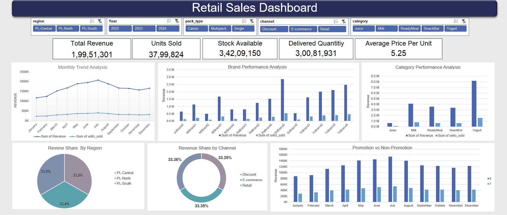

# Retail Sales Analysis-Dashboard-Excel
Interactive Excel Dashboard analyzing business KPIs, performance trends, and actionable insights.

## Project Overview
This project presents an end-to-end exploratory data analysis and interactive dashboard built in Microsoft Excel. The goal of this case study is to clean raw business data, analyze key performance metrics, uncover actionable business insights, and present key findings through a dynamic, visual executive dashboard.

## Key Features & Highlights
- Data Cleaning & Preprocessing: Handled missing values, standardized data types, and prepared the core dataset for modeling.
- Formulas & Business Logic:Implemented dynamic Excel functions and created calculated metrics.
- Pivot Tables & Aggregations: Analyzed category-wise performance, time-series trends, and regional distributions.
- Interactive Executive Dashboard: Designed an intuitive dashboard featuring interactive slicers, KPI summary scorecards, and visually clean charts (bar, line, and donut charts) for senior management review.

## Dashboard Preview

## Business Insights & Takeaways
- Highlighted key revenue drivers and underperforming segments across product lines/regions.
- Identified seasonal trends and sales spikes to support demand forecasting.
- Delivered executive KPIs for swift decision-making and operational tracking.

## Tools Used
Tools Used: Microsoft Excel (Power Query, Pivot Tables & Charts, Dynamic Slicers, and Advanced Formulas).
